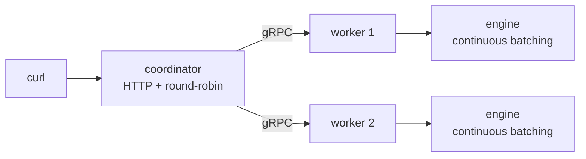

# inferium

A CPU inference engine for Llama-architecture LLMs, written from scratch in C++17 with
**no ML libraries** — no BLAS, no ggml, no PyTorch. It memory-maps a GGUF file,
dequantizes the weights, runs the transformer forward pass by hand, serves concurrent
requests over HTTP with continuous batching, and distributes them across worker nodes
over gRPC.

Built as a learning project to understand memory bandwidth, SIMD, thread scheduling, and
where inference actually spends its time.

## What it does

- **GGUF loading** — `mmap`s the model file and parses metadata, tensor descriptors, and
  the SentencePiece vocabulary
- **Quantization** — dequantizes `Q4_K` and `Q6_K` super-block formats
- **Transformer** — RMSNorm, RoPE, grouped-query attention, SwiGLU feed-forward, greedy
  sampling
- **KV-cache** — decode processes one position per token instead of reprocessing the prompt
- **NEON SIMD** — hand-vectorized dot products with four independent accumulators
- **Thread pool** — mutex/condvar work queue; matmul rows are split across cores
- **Arena allocator** — activations come from a bump allocator, not `malloc`
- **Continuous batching** — concurrent requests join a running batch and share one pass
  over the weights
- **HTTP API** — JSON `/generate` endpoint
- **Distributed** — gRPC coordinator round-robins across workers with timeout and failover

## Architecture



Inside a worker, one scheduler thread owns all model compute. Request threads only enqueue
and wait on a future. This is deliberate: the matmul already parallelizes across the thread
pool, so running requests *on* that same pool would let a blocked worker wait on subtasks
it is itself supposed to run. A single scheduler thread avoids the nested-parallelism
deadlock entirely and keeps the weights hot in cache across sequences.

## Build

```bash
cmake -S . -B build -DCMAKE_PREFIX_PATH=/opt/homebrew
cmake --build build -j
```

gRPC and protobuf are optional — without them the distributed targets are skipped and
everything else still builds.

## Run

Single-shot CLI:

```bash
./build/inferium model.gguf "The capital of France is"
```

HTTP server:

```bash
./build/inferium_server model.gguf --port 8080 --batch 8 --threads 8
curl -X POST http://127.0.0.1:8080/generate \
  -H 'Content-Type: application/json' \
  -d '{"prompt":"The capital of France is","max_tokens":32}'
```

Distributed — two workers behind a coordinator:

```bash
./build/inferium_worker model.gguf --port 50051 --batch 4 --threads 4 &
./build/inferium_worker model.gguf --port 50052 --batch 4 --threads 4 &
./build/inferium_coordinator --workers 127.0.0.1:50051,127.0.0.1:50052 --port 9090
curl -X POST http://127.0.0.1:9090/generate -d '{"prompt":"Hello","max_tokens":32}'
```

Benchmark:

```bash
./build/inferium_bench model.gguf --requests 16 --concurrency 8 --batch 8 --threads 8
```

## Benchmarks

Apple M4 (4 performance + 6 efficiency cores, 24 GB LPDDR5, ~120 GB/s),
TinyLlama-1.1B-Chat `Q4_K_M`, prompt `"The capital of France is"`.

### Optimization history — single-stream decode

| Stage | tok/s | vs baseline |
|---|---:|---:|
| Naive (no KV-cache, scalar, 1 thread) | 0.13 | 1× |
| \+ parallel matmul (8 threads) | 0.42 | 3.4× |
| \+ KV-cache | ~2.5 | 20× |
| \+ NEON SIMD | 6.5 | 52× |
| \+ arena and batched matmul (8 threads) | **9.2** | **~70×** |

The naive baseline reprocessed the whole sequence every token, so its per-token cost grew
with sequence length — the early numbers are worse on longer runs, not better.

### Thread scaling (single stream)

| Threads | tok/s | Speedup |
|---:|---:|---:|
| 1 | 6.43 | 1.00× |
| 2 | 8.16 | 1.27× |
| 4 | 8.82 | 1.37× |
| 8 | **9.18** | **1.43×** |
| 10 | 8.83 | 1.37× |

Early on, 8 threads bought 3.4×. After SIMD and the KV-cache removed most of the compute,
the same 8 threads buy only 1.43×. **Optimizing compute moved the wall closer**: at batch
size 1 every weight is read from memory exactly once and used for a single multiply, so
decode is bound by memory bandwidth, not cores. Ten threads is slower than eight —
the efficiency cores add contention without adding bandwidth.

### Batch scaling (throughput, 8 threads)

| Batch | tok/s | p50 latency |
|---:|---:|---:|
| 1 | 6.2 | 3.4 s |
| 2 | 9.6 | 4.4 s |
| 4 | 14.5 | 5.7 s |
| 8 | **15.5** | 12.6 s |
| 16 | 17.1 | 22.4 s |

**~2.5× throughput at batch 8** (median of 3 runs; run-to-run variance is roughly ±15%).

This is the payoff for the bandwidth finding above. Batching does not make any single
matmul faster — it amortizes the weight *load*. `mat_mat` loads one weight vector into a
register and issues four FMAs against four different sequences, so eight sequences cost
roughly the memory traffic of two. Gains flatten past batch 4–8 because attention is
per-sequence work that batching cannot share, and each sequence's KV cache competes for
the same cache lines.

The latency column is the honest cost: p50 grows from 3.4 s to 12.6 s. Batching trades
per-request latency for aggregate throughput.

### Memory

| | |
|---|---|
| Model on disk (Q4_K_M) | 638 MB |
| Peak RSS | 4.82 GB |

Weights are dequantized to `float32` once at load, which costs ~7.5× the file size. See
limitations.

### Fault tolerance

With two workers behind the coordinator: killing one worker mid-run keeps every request
succeeding (the round-robin cursor advances on retry, so a retry never lands on the worker
that just failed). Killing both returns `HTTP 503` with the underlying gRPC error rather
than hanging.

## Limitations

- **Weights are dequantized at load.** Keeping them in `Q4_K` and dequantizing per block
  inside the matmul would cut memory ~4× *and* speed up decode, since the bottleneck is
  bytes moved. This is the single highest-value remaining change.
- **Greedy sampling only** — no temperature, top-k, or top-p.
- **Attention is scalar** and recomputes over the full history each step; it is the main
  reason batch gains flatten.
- **No streaming** — responses return only when generation completes.
- **Each worker loads its own full copy** of the model, so two workers on one machine
  share the same memory bandwidth and provide redundancy rather than speedup. Distribution
  pays off across separate machines.
- Prompts are truncated by `--max-seq` (default 512) and requests over it are rejected.
